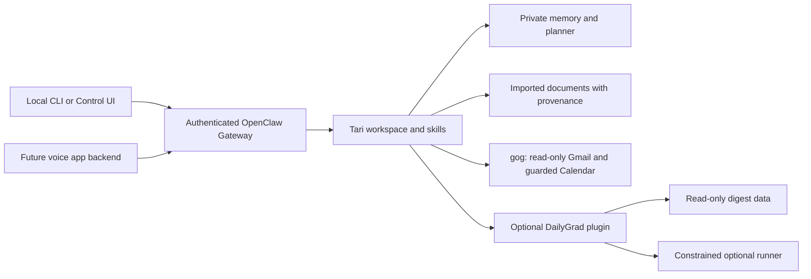

# Tari Public v0.1

**Thoughtful Assistant for Routine & Information.** A portable personal assistant for
email, schedules, documents, and the work you want to get done. Run your own instance
locally with your own model credentials and optional Google account.

Tari is built on [OpenClaw](https://github.com/openclaw/openclaw). OpenClaw provides
model execution, chat sessions, agent tools, memory facilities, and the Gateway UI/API.
This project adds Tari's behavioural instructions, provenance rules, a persistent day
planner, guarded Google helpers, document intake, and a small isolated deployment.
It does not implement a model or a new agent framework.



Included in the core installation:

- Local chat with persistent conversation identifiers; no Discord requirement.
- Editable identity, preferences, domain notes, and user-authorized memory.
- Gmail search, message reading, triage, and summaries using read-only OAuth scopes.
- Calendar reads; optional proposal-based writes verified by reading the event back.
- Planner blocks, commute blocks, free-time checks, tasks, and checklists, independent of Calendar.
- Text, Markdown, text-based PDF, and basic DOCX intake with source hashes and timestamps.
- On-demand daily briefs with bounded source collection and honest missing-source reporting.
- Configurable IANA timezone with one command to change it across the installation.
- An authenticated local API for future clients.

After optional [DailyGrad setup](docs/dailygrad.md), six tools provide digest history,
generation, repair, source preferences, and LeetCode exercise status/progress. Its data
and runner can be completely absent without preventing ordinary Tari use.

The runtime pins **OpenClaw 2026.9.9** and **gog 0.40.0**, matching the reusable source
implementation. The thin Docker overlay uses the upstream prebuilt image and verifies
gog archive checksums for arm64 and amd64. No upstream checkout is required.

## Quickstart

Prerequisites: Git, Python **3.10+** with IANA timezone data, and Docker Desktop or Docker
Engine with Compose v2. macOS Apple Silicon is supported; Linux and Windows through WSL2
use the same commands. Run these commands inside this checkout, not a shared parent workspace.

```sh
git clone https://github.com/SpaceJesusTM/tari-public.git
cd tari-public
./tari init --timezone UTC
```

Edit **`.local/runtime.env`** and set `OPENAI_API_KEY` to your own API key. The default
model is `openai/gpt-6.1-sol`; choose another compatible provider/model at initialization:

```sh
./tari init --timezone UTC --model anthropic/claude-sonnet-4-6 --name Tari
```

Choose initialization options on the **first run**. Initialization only creates missing
files: it never overwrites an existing installation or rotates its secrets. For an existing
installation, change timezone with `./tari timezone Europe/Berlin`; this synchronizes
the runtime environment, OpenClaw configuration, managed user timezone, and optional
DailyGrad settings. It recreates running services and leaves stopped ones stopped.
For model/name changes, edit `.local/runtime.env` and
`.local/state/openclaw.json`; edit the private identity to match. Provider keys
are runtime environment entries: `OPENAI_API_KEY`, `ANTHROPIC_API_KEY`, or `OPENROUTER_API_KEY`.
Other OpenClaw providers can be configured using `./tari openclaw models --help`.

```sh
./tari start
./tari doctor
./tari chat
```

Chat is available at **http://127.0.0.1:18899/** as well. Use `./tari token` to reveal your
local Gateway token and paste it into the Control UI connection settings. Treat it as a
password; do not share screenshots or token-bearing URLs. If the UI requests device pairing,
use `./tari openclaw devices list` and approve only your local browser with
`./tari openclaw devices approve <request-id>`.

Initial image downloads can take several minutes. Chat requires an available model and
valid provider credentials. Google authorization is a separate setup and takes longer.

```sh
./tari chat --session demo "Call this conversation my planning demo."
./tari chat --session demo "What did I call this conversation?"
./tari status
./tari logs
./tari stop
```

The same `--session` value continues the same conversation across CLI invocations;
choose a different value for a separate thread. Interactive chat uses `local-cli` by default.
`stop` removes only this installation's Compose services/network and keeps its data.

## Private state and configuration

All generated state lives in ignored **`.local/`**, beneath this checkout:

| Location | Purpose |
| --- | --- |
| `.local/runtime.env` | Model credentials, unique Gateway/keyring secrets, timezone, host UID/GID, port, unique Compose project ID |
| `.local/state/openclaw.json` | Private runtime configuration |
| `.local/state/workspace/` | This installation's editable Tari instructions, notes, planner, and documents |
| `.local/google/` | This installation's gog OAuth clients and encrypted file keyring |

Tracked `workspace/` files are **clean starter templates**. `init` seeds missing files
into the private workspace. Editing a tracked template does not silently replace an owner's
notes or instructions; apply reviewed instruction/helper updates to the private workspace
deliberately. Keep credentials out of workspace Markdown.

`USER.md` holds stable preferences; `MEMORY.md` holds durable context; `domains/` holds
active facts, tasks, and commitments with provenance. None contains an imported personal
profile. OpenClaw retains session history independently. Tell Tari explicitly which facts
to remember; imported documents and email do not automatically become obligations.
Semantic memory search depends on the OpenClaw memory provider configuration; plain files
and session continuity work without a new embedding service.

By default the container sees only this installation's state and Google directory. It has no host
home mount or Docker socket. The Gateway binds inside its container for Docker forwarding;
the host publishes **only loopback**, on a separate default port. Pick another free port
with `./tari init --port 18999` on first use.

Optional DailyGrad setup adds reviewed plugin code, read-only selected digest data,
and a read-only socket volume; the standalone package stays in the separate runner.

## Google setup

Follow [Google authorization and verification](docs/google.md). Initial chat and local
planner/checklist operations do not require Google. Gmail uses a named read profile with
`gmail.readonly`; Calendar write credentials are separate and optional.

After authorizing, run:

```sh
./tari exec ./bin/tari-google gmail search 'newer_than:7d' --max 20
./tari exec ./bin/tari-google calendar list --start 2026-11-02T00:00:00Z --end 2026-11-03T00:00:00Z --json
```

Mail and documents are untrusted content. Tari's instructions preserve source precedence,
report retrieval limits, and prohibit treating embedded instructions as user commands.
Shared calendars provide context: events count as commitments only under the documented
ownership/participation rules. Unknown or declined attendance is not confirmed participation.
See [security boundaries](SECURITY.md) for what OAuth scopes enforce and what relies on
agent behavior.

## Day Planner

Ask Tari, “Add a **Planner block** tomorrow from 13:00–14:00 for prototype work,” or
“Show my day planner.” A request for advice does not save a plan. A bare “schedule this”
must be clarified as a planner block or Calendar event before changing either.

The retained planner helper can also be used directly:

```sh
./tari exec ./bin/day-planner show today
./tari exec ./bin/day-planner add tomorrow 13:00-14:00 "Prototype work"
./tari exec ./bin/day-planner free tomorrow --after 12:00 --before 18:00 --min 90m
./tari exec ./bin/day-planner section-add "Demo"
./tari exec ./bin/day-planner task-add "Demo" "Review prototype" --status priority
./tari exec ./bin/day-planner checklist
./tari exec ./bin/day-planner task-complete "Review prototype"
```

Use `./tari exec ./bin/day-planner --help` for all commands. Blocks persist in private
workspace `planner/` files, not Google Calendar. Overlaps are refused until the specific
overlap is approved and retried with `--allow-overlap`. Calendar failures block time-block
changes; if the user explicitly accepts an unchecked change, use `--no-calendar`. In
chat-only mode, an intentional offline example is:

```sh
./tari exec ./bin/day-planner add tomorrow 13:00-14:00 "Prototype work" --no-calendar
```

The helper clearly marks unavailable Calendar checks. It does not need a Discord channel,
dashboard, external database, or background job. Checklist edits do not require Google.

## Document intake

Place only the selected files inside the private workspace (no whole home-directory mounts):

```sh
mkdir -p .local/state/workspace/inbox
cp examples/demo-notes.md .local/state/workspace/inbox/
./tari exec ./bin/document-import import inbox/demo-notes.md
./tari exec ./bin/document-import list
```

The helper prints a source ID. Ask Tari to read that imported source, summarize it, and cite
its source ID. Ask separately to record any extracted dates, personal facts, or commitments.
It stores a bounded text extraction and a provenance manifest under private `documents/`;
there is no vector database or automatic commitment extraction. Run the helper with `--help`
for source listing/viewing commands and format limits.

PDF requires selectable text; OCR, encrypted PDFs, layout fidelity, and tables are not
supported. DOCX extracts basic paragraph text, without executing macros or embedded objects.
Imported source text remains untrusted even after you select the document as evidence.

Fictional demo: import `examples/demo-notes.md`, ask “What dates are mentioned?”, then
“Add a Planner block tomorrow 13:00–14:00 for the prototype, without checking Calendar.”
Finally, “Show my planner and tell me whether you checked Calendar.” This demonstrates
grounding, explicit authorization, persistent planning, and honest uncertainty.

## External clients and extensions

The built-in, authenticated **`POST /v1/chat/completions`** endpoint targets the stable
assistant ID **`tari`** through `model: "openclaw/tari"`. Reuse `user` per conversation.
See [API contract and Python example](docs/api.md). No custom bridge service is required.
Future voice applications should keep the Gateway token in their backend; browsers should
never receive it or mount assistant state. Boson/Higgs is not integrated in v0.

Add focused workflows as workspace skills. DailyGrad is an optional separate dependency;
the six-tool plugin reads its selected output directory through a read-only mount.
The optional constrained runner is a separate container, with no published port or Tari
credentials. See [DailyGrad setup](docs/dailygrad.md) for generation/repair opt-ins, news
source changes, exercise preferences, troubleshooting, and disabling the integration.
No automatic DailyGrad runs or posting are installed.

## Daily briefs and timezone

Ask “Give me my morning brief,” “What are my priorities today?”, “Help me plan my day,”
or “What's coming up tomorrow?” Tari combines available domain notes, preferences,
planner/checklist state, Calendar, and bounded Gmail retrieval. A quiet day gets a short
brief. Unavailable Google sources are disclosed; they are never treated as empty.
DailyGrad appears only when relevant and configured. A brief never writes a plan,
creates Calendar events, or starts a DailyGrad run.

```sh
./tari timezone
./tari timezone Europe/Berlin
./tari exec ./bin/tari-brief-context tomorrow
```

The helper collects source context; Tari's model writes the adaptive natural-language
brief. It can collect local context without Google or DailyGrad. Mail is the first 20
messages from the recent 48 hours, including read and unread, rather than a complete
inbox recap. Calendar windows use local midnight and DST-aware offsets. UTC is the
default; invalid IANA timezones produce a clear error.

For an existing v0 installation, update the distributed helpers/skills and deliberately
replace startup instructions after reviewing your customizations:

```sh
./tari workspace-update --instructions
./tari start
```

This preserves USER, IDENTITY, MEMORY, domains, planner data, documents, credentials,
and user-added files. Distributed helpers/skills are refreshed; `--instructions` also
replaces AGENTS, SOUL, TOOLS, and HEARTBEAT. Omit that flag to preserve customized startup
instructions and merge their relevant changes yourself.

## Validation and limitations

```sh
python3 -B -m unittest discover -s tests -v
node --test tests/dailygrad-plugin/*.test.mjs
python3 scripts/scan_public.py
```

Tests use fictional fixtures and mocked Google subprocesses. See [v0.1 readiness and
owner acceptance](docs/readiness.md) for the actual checks performed and live checks
still needed. No real model or Google credential is included. A successful health probe
does not prove a model reply or OAuth access works.

This is a trusted, single-owner local assistant. Full OpenClaw tools execute inside its
container. Wrapper confirmations and Markdown instructions are not a separate malicious-agent
sandbox. Calendar writes can affect owned events; enable them only when needed. There are
no scheduled briefs, proactive notifications, or reminder delivery configured; briefs
are on demand. Portability to Linux/WSL is designed but should be verified on those hosts.
Dependencies are compatibility pins, not a promise of indefinite security support; review
upstream advisories before deployment beyond a local development environment.

Next: a secure voice backend and carefully scoped reminders. Useful changes from private
Tari are transferred through deliberate source review,
sanitization, focused tests, and public diff review. The repositories do not mirror each
other and share no Git history or runtime state. See [curation notes](docs/implementation.md).

MIT license: the existing [LICENSE](LICENSE) is preserved. OpenClaw and gog retain their
own upstream licenses.
