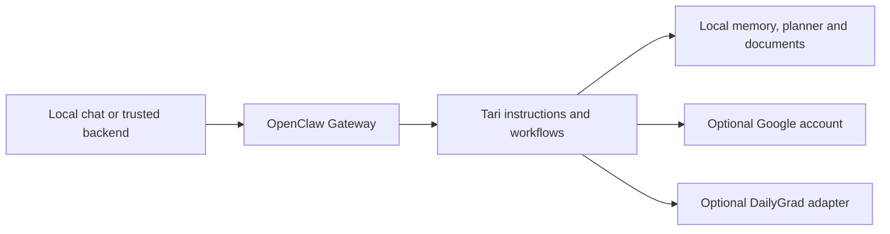

# Tari

**Thoughtful Assistant for Routine & Information**

A personal AI assistant for keeping daily life, work, and projects organized through
conversation. Ask Tari to help you plan the day, find important information, work
through documents, or pick up where you left off—with your own model and local state.

## Features

| | What you can do |
| --- | --- |
| **Conversation** | Chat locally or connect optional native OpenClaw Discord; return to your conversations later. |
| **Gmail & Calendar** | Search and summarize mail, review schedules, and authorize specific event changes. Optional Google setup. |
| **Day Planner** | Manage time blocks, tasks, checklists, and commute time separately from Calendar. |
| **Documents & memory** | Import text, Markdown, PDF, or DOCX with provenance; ask Tari to remember selected information. |
| **Daily briefs** | Request an overview now, or explicitly enable a daily brief with your chosen model, time, and destination. |
| **Reminders** | Opt into exact one-shot reminders; delivery needs no additional model call. |
| **Timezone** | Use your IANA timezone consistently for local dates, planning, and briefings. |
| **DailyGrad** | Optionally add AI news digests, micro-lessons, and LeetCode exercises, with controls for generation and progress. |

Google, DailyGrad, Discord, and scheduled delivery are optional. Start with chat,
local planning, and documents, then connect the services you want.

## Quick Start

You'll need **Git**, **Python 3.10+** with IANA timezone data, and **Docker Desktop or
Docker Engine with Compose v2**. Use your own model-provider credentials; the default
model is `openai/gpt-6.1-sol`.

> The runnable release is currently on `feat/tari-public-v0`. Once it is merged into
> `main`, omit `--branch feat/tari-public-v0` from the clone command.

```sh
git clone --branch feat/tari-public-v0 https://github.com/SpaceJesusTM/tari-public.git
cd tari-public
./tari init --timezone UTC
```

Edit **`.local/runtime.env`** and set `OPENAI_API_KEY` to your own API key. Then:

```sh
./tari start
./tari chat
```

The first start downloads and builds the runtime image and can take several minutes.
No Google OAuth or DailyGrad setup is needed. For another model or OpenClaw-managed
authentication, see the [setup guide](docs/setup.md#model-authentication).

Prefer a browser? Open **http://127.0.0.1:18899/** and enter the token shown by
`./tari token` in the local Control UI settings. Keep that token private.

Try asking:

- “Give me my morning brief.”
- “Add a task to my planner checklist.”
- “Summarize the document I imported and show its source.”

Use `./tari doctor` to check setup and `./tari stop` to shut down while keeping your
data. See [everyday usage](docs/usage.md) for planner commands and document import.

## Integrations

**Gmail & Calendar.** Connect your own Google account to read schedules and search,
read, or summarize messages. Gmail uses read-only authorization. Calendar writes
are disabled by default and use a separate permission setup, reviewed proposals,
and read-back verification. [Google setup →](docs/google.md)

**DailyGrad.** Connect the separate [DailyGrad](https://github.com/SpaceJesusTM/dailygrad)
project for news digests, lessons, and conceptual LeetCode practice. Read current or
historical digests without a runner; optionally enable generation, repair, source
preferences, and exercise controls through the constrained runner. Nothing runs on
a schedule. [DailyGrad setup →](docs/dailygrad.md)

**Discord & scheduled delivery.** Install OpenClaw's official Discord plugin when
you want it, then use native pairing, guild allowlists, and channel conversations.
Separately opt into a morning brief (its own time, timezone, model, and thinking
level, independent of chat) or deterministic reminders, each with an explicit
destination. [Discord →](docs/discord.md) · [Briefs & reminders →](docs/automation.md)

## How it works

[OpenClaw](https://github.com/openclaw/openclaw) powers Tari's agent runtime, model
execution, conversation sessions, and Gateway UI/API. Tari adds assistant behavior,
source and consent rules, personal workflows, the planner, document intake, Google
and DailyGrad adapters, and an isolated local deployment.



The core runs in one container. This installation's settings, credentials, and
persistent data stay under Git-ignored `.local/`. The optional DailyGrad runner is
a separate service; Tari receives its selected digest data read-only.

## Configuration & extensions

- **Personality and memory:** customize the active files under
  `.local/state/workspace/`, including `SOUL.md`, `IDENTITY.md`, `USER.md`, and `MEMORY.md`.
- **Timezone:** run `./tari timezone Europe/Berlin`, or choose another IANA zone.
- **Models and updates:** follow [configuration and maintenance](docs/setup.md).
- **Workflows:** add focused skills to the active workspace.
- **External applications:** use the authenticated local API with the stable
  `tari` agent ID. Keep Gateway credentials in a trusted backend.
  [API documentation →](docs/api.md)

## Security & limitations

Tari is designed for a **trusted, single-owner local installation**. Its agent can
use tools and access its own mounted data. Protect `.local/` and the Gateway token;
do not expose the full Gateway to an untrusted browser or third-party service.

Gmail cannot send or modify messages through its read-only grant. Calendar proposal
tokens are workflow checks, not independent proof of human approval. Imported mail,
documents, and digests remain untrusted content. See [SECURITY.md](SECURITY.md).

PDF intake needs selectable text; OCR is not included. Semantic memory search needs
an appropriate OpenClaw provider. Discord starts uninstalled, and no background
model work runs by default: no jobs, heartbeat off, autonomous skill learning off.
Scheduled delivery needs a running host/Gateway. Live Discord delivery and
model-backed scheduled briefs still need owner acceptance; voice integration is
not included. Linux/WSL and amd64 runtime checks remain part of release acceptance.
See [v0.1 readiness](docs/readiness.md) for what has been verified.

## Documentation

- [Setup, authentication, and configuration](docs/setup.md)
- [Everyday usage: chat, planning, documents, and briefs](docs/usage.md)
- [Google authorization](docs/google.md)
- [Optional DailyGrad integration](docs/dailygrad.md)
- [Native Discord setup](docs/discord.md)
- [Optional morning briefs and reminders](docs/automation.md)
- [Local API](docs/api.md)
- [Security](SECURITY.md)
- [Release readiness and owner acceptance](docs/readiness.md)

## Project Origins

Tari began as a private personal AI assistant, developed and refined through ongoing
use and experimentation. Its planning, memory, Google and DailyGrad integrations,
and personalized workflows grew alongside that work.

This repository is a curated, standalone open-source edition, independently
maintained and adapted for portable, reproducible setup and use by other developers.
Personal data, runtime state, private infrastructure, and deployment-specific
configuration remain separate. Tari builds on OpenClaw's agent runtime, with
additional assistant behavior, integrations, and workflows developed around it.

## License

[MIT](LICENSE). OpenClaw, gog, and optional dependencies retain their own licenses.
